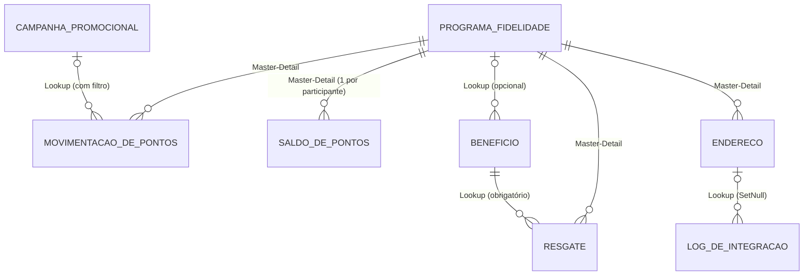

# Relatório Final — PontoCerto (Programa de Fidelidade)

Projeto baseado no **Tópico 4 — Programa de Fidelidade** do documento *Temas de Projetos* (mais os requisitos
obrigatórios para todos os projetos). Objetivo oficial: *gerenciar pontuação, benefícios, resgates e campanhas
de fidelização.*

## 1. Resumo

| Item | Resultado |
|---|---|
| Objetos customizados | 8 (os 6 do Tópico 4 + Endereço + Log de Integração) |
| Flows | 3 Record-Triggered, 1 Screen Flow, 2 Subflows |
| Processo de aprovação | 2 níveis (Coordenador → Diretor), por valor (acima de 1.000 pontos) |
| Apex | 13 classes e 1 trigger; **44 testes, 100% passando, 99% de cobertura** (mínimo exigido: 85%) |
| Interface | Lightning App, 3 páginas Lightning (Dynamic Forms e Dynamic Actions), 3 LWCs |
| Analytics | 4 relatórios, 2 dashboards |
| Segurança | 3 perfis, 3 papéis, Role Hierarchy, Sharing Rule por critério, Permission Set |
| Integração | ViaCEP com Apex Callout, Queueable e log de auditoria (testado com a API real) |
| Marca | Nome **PontoCerto**, logomarca e paleta |

## 2. Modelo de dados



| Objeto | Papel | Origem |
|---|---|---|
| Programa Fidelidade | Armazena o participante (adesão do cliente) e os Roll-Ups | PDF |
| Movimentação de Pontos | Transação de entrada (acúmulo ou ajuste) | PDF |
| Resgate | Transação de saída (troca por benefício) | PDF |
| Saldo de Pontos | Calcula: fórmulas Saldo Atual e Categoria Atual | PDF |
| Benefício | Catálogo, com Record Types Cashback, Desconto e Brinde | PDF |
| Campanha Promocional | Catálogo de campanhas com multiplicador e vigência | PDF |
| Endereço | Endereço do participante (exigido pelo ViaCEP) | PDF (requisito geral) |
| Log de Integração | Auditoria das consultas ao ViaCEP | Decisão técnica |

**Por que Master-Detail onde há Roll-Up:** o Roll-Up Summary só existe no pai de uma relação principal-detalhe.
Por isso Movimentação e Resgate são Master-Detail do Programa. Excluir o Programa exclui os filhos, e os filhos
herdam o acesso do pai (a Sharing Rule do Programa vale para todos).

## 3. Requisito × decisão × melhoria opcional

**Explícito no PDF:** tudo da matriz da seção 5.

**Decisões técnicas** (o PDF não define; foram propostas e confirmadas):

| # | Decisão |
|---|---|
| D1 | Programa Fidelidade = adesão de um cliente; Saldo de Pontos = objeto 1:1 que hospeda as fórmulas |
| D2 | Acúmulo de 1 ponto por R$ 1; pontos finais = Pontos Base × multiplicador da campanha (ajustes não multiplicam) |
| D3 | Saldo Atual = Total de Pontos − Total de Resgates |
| D4 | Categorias pelo total acumulado: Bronze < 1.000, Prata de 1.000 a 4.999, Ouro ≥ 5.000 |
| D5 | Aprovação acima de **1.000 pontos**; nível 1 Coordenador, nível 2 Diretor |
| D6 | Clientes ativos = Status Ativo e movimentação nos últimos 90 dias; Engajamento = movimentações por semana nos últimos 30 dias |
| D7 | Trigger Framework próprio (classe base + um handler por trigger) |
| D8 | Usuários de demonstração e perfis na licença Salesforce Platform |
| D9 | O Roll-Up Total de Resgates ignora resgates **Rejeitados**: um resgate pendente já reserva os pontos, e a rejeição devolve o saldo automaticamente |
| D10 | ViaCEP acionado por **Trigger + Queueable** (uma das 3 opções do PDF); acesso por Remote Site Setting |
| D11 | O limite de aprovação fica em um único lugar: o Subflow `Sub_Verificar_Limite` |
| D12 | Permissão personalizada `Ajustar_Pontos` (via Permission Set) controla quem registra movimentações do tipo Ajuste |
| D13 | Campanha só aceita movimentações na vigência e ativa, por filtro na relação de pesquisa (sem código) |

**Melhorias opcionais não implementadas:** validade de pontos, e-mail de notificação, Batch/Schedulable de fechamento
mensal, testes Jest dos LWCs, logo dentro do app (como recurso estático).

## 4. Automações

| Flow | Tipo / evento | Função |
|---|---|---|
| `RT_Programa_Criar_Saldo` | Record-Triggered, depois de criar Programa | Cria o Saldo de Pontos do participante |
| `RT_Movimentacao_Calcular_Pontos` | Record-Triggered, antes de salvar Movimentação | Pontos = Pontos Base × multiplicador (ajuste não multiplica) |
| `RT_Resgate_Direcionar_Aprovacao` | Record-Triggered, depois de criar Resgate | Chama o Subflow de limite: abaixo, aprova sozinho; acima, envia à aprovação |
| `SF_Novo_Resgate` | Screen Flow (ação "Novo Resgate" no Programa) | Mostra saldo, lista benefícios elegíveis, valida e cria o Resgate |
| `Sub_Verificar_Limite` | Subflow | Informa se os pontos exigem aprovação (limite de 1.000) |
| `Sub_Validar_Resgate` | Subflow | Valida benefício ativo e saldo suficiente |

Processo de aprovação `Aprovacao_de_Resgate`: critério `Exige_Aprovacao__c = verdadeiro`; **nível 1** Coordenador,
**nível 2** Diretor; aprovado → Status `Aprovado`; rejeitado → Status `Rejeitado` (pontos de volta ao saldo).

## 5. Matriz de requisitos

Legenda: **Validado** = há teste automatizado ou verificação por consulta/API com resultado conferido.
**Implantado** = está no org e foi aceito pela validação do Salesforce, mas a conferência visual na tela é sua (seção 7).

| ID | Requisito (origem no PDF) | Implementação | Estado | Evidência |
|---|---|---|---|---|
| R-01 | 3 perfis (Segurança) | Perfil Operacional, Gestor, Administrativo | Validado | `SegurancaFidelidadeTest` (3 testes, executados como cada perfil) |
| R-02 | 3 papéis | Operador, Coordenador, Diretor | Validado | Usuários demo com os papéis (consulta ao org) |
| R-03 | Role Hierarchy | Diretor > Coordenador > Operador; OWD do Programa = Privado | Validado | Teste: Coordenador vê o cliente do Operador; outro Operador não vê |
| R-04 | Sharing Rule por critério | `Clientes_VIP_para_Operadores` (Cliente VIP = verdadeiro → papel Operador, leitura) | Validado no org | Linha em `Programa_Fidelidade__Share` com `RowCause = Rule`, `Read`, grupo do papel Operador (*) |
| R-05 | Permission Set para função especial | `Ajuste de Pontos` + permissão `Ajustar_Pontos` | Validado | `ajusteDePontosExigeOPermissionSet` |
| R-06 | Mínimo de 5 objetos | 8 objetos | Validado | Metadados no repositório |
| R-07 | Master-Detail | Movimentação, Resgate, Saldo, Endereço → Programa | Validado | Deploy + testes |
| R-08 | Lookup | Campanha→Movimentação, Benefício→Programa, Resgate→Benefício, Log→Endereço | Validado | Deploy + testes |
| R-09 | Fórmulas (Saldo Atual, Categoria Atual) | Em Saldo de Pontos | Validado | `categoriaSegueAsFaixasDePontos`, fluxo ponta a ponta |
| R-10 | Roll-Ups (Total de pontos, Total de resgates) | Em Programa (+ Última Movimentação) | Validado | Total de Pontos = 2000, Total de Resgates = 500 conferidos |
| R-11 | Record Types em Benefício | Cashback, Desconto, Brinde | Validado | `tiposDeRegistroDoBeneficioExigemOsCamposCertos` |
| R-12 | Page Layouts por perfil | Programa (3 layouts), Resgate (2), Benefício (1 por tipo) | Implantado | Atribuições nos perfis; conferir visualmente |
| R-13 | 3 Record-Triggered Flows | RT Programa, RT Movimentação, RT Resgate | Validado | Fluxo ponta a ponta e `AutomacaoFidelidadeTest` |
| R-14 | 1 Screen Flow | `SF_Novo_Resgate` | Implantado | Ativo no org; **não executei as telas** (seção 7) |
| R-15 | Subflows | `Sub_Verificar_Limite` (usado por RT e Screen Flow), `Sub_Validar_Resgate` | Validado | Subflow de limite no RT-3; validação executada pela API (3 cenários) |
| R-16 | Aprovação com 2 níveis | Coordenador → Diretor | Validado | Aprovação pelos 2 níveis e rejeição executadas e conferidas |
| R-17 | Aprovação por valor / acima de limite | Acima de 1.000 pontos | Validado | 500 pts aprovado sozinho; 1.500 pts em aprovação |
| R-18 | Trigger Framework | `TriggerHandler` + `EnderecoTrigger` + `EnderecoTriggerHandler` | Validado | `TriggerHandlerTest`, `EnderecoTriggerTest` |
| R-19 | Integração ViaCEP (Apex Callout) | `ViaCepService` | Validado | Teste com mock **e** consulta real (Avenida Paulista) |
| R-20 | Queueable ou Batch | `ViaCepQueueable` | Validado | Testes, inclusive lote acima de 50 |
| R-21 | Cobertura de testes ≥ 85% | 44 testes | Validado | **99%** de cobertura, 100% de aprovação |
| R-22 | Objeto de endereço (7 campos) | `Endereco__c` | Validado | CEP, Logradouro, Número, Complemento, Bairro, Cidade, Estado |
| R-23 | Preencher campos automaticamente | Queueable atualiza o Endereço | Validado | Consulta real preencheu os campos |
| R-24 | Tratar CEP inválido e erros | Formato (validação), inexistente, HTTP, rede | Validado | `12AB` recusado; `99999-999` → Status Erro |
| R-25 | Logs de integração para auditoria | `Log_de_Integracao__c` | Validado | Logs de sucesso e de erro gravados |
| R-26 | Lightning App personalizada | `PontoCerto` | Implantado | Conferir visualmente |
| R-27 | Dynamic Forms | Seções com visibilidade condicional nas 3 páginas | Implantado | Aceito pela validação do Salesforce; conferir visualmente |
| R-28 | Dynamic Actions | Ação "Novo Resgate" visível só com Status Ativo | Implantado | Idem |
| R-29 | 2 a 3 LWCs | `saldoPontosCard`, `beneficiosDisponiveis`, `consultaCepStatus` | Implantado | Apex do controlador testado (100%); **tela não conferida** |
| R-30 | Dashboard Executivo (Engajamento, Clientes ativos) | `Dashboard_Executivo` | Validado (números) | Relatórios conferidos com SOQL; aparência é sua |
| R-31 | Dashboard Operacional (Resgates pendentes, Pontuação acumulada) | `Dashboard_Operacional` | Validado (números) | Idem |
| R-32 | Repositório dedicado | GitHub `programa-fidelidade-salesforce` | Em andamento | Falta você commitar e enviar o trabalho recente (seção 8) |
| R-33 | Marca: nome, identidade, logomarca | PontoCerto, paleta, SVGs | Validado | `docs/marca/` |

(*) A Sharing Rule cria o compartilhamento de forma **assíncrona**, logo após o commit. Por isso ela não pode
ser comprovada dentro de um teste Apex, e a evidência vem da tabela de compartilhamento do org.

## 6. Resultados dos testes

- **Apex:** 44 testes, 100% aprovados; cobertura geral 99% (TriggerHandler 100%, EnderecoTriggerHandler 100%,
  ViaCepService 100%, FidelidadeController 100%, ViaCepQueueable 98%).
- **Cenário ponta a ponta (Fase 5):** criação do Saldo, cálculo com campanha (300 × 2 = 600), ajuste negativo
  sem multiplicador, categoria Prata com 2.000 pontos, resgate pequeno aprovado sozinho, resgate grande
  pendente, pontos reservados, recusa por saldo insuficiente, aprovação em 2 níveis, rejeição devolvendo 1.500 pontos.
- **ViaCEP real:** `01310100` → `01310-100`, Avenida Paulista, Bela Vista, São Paulo, SP; `99999-999` → Erro com log.

## 7. O que NÃO foi conferido visualmente e precisa da sua verificação

Eu validei por API, testes e consultas, mas não abri o navegador. Confira estes itens antes de apresentar:

1. **Lightning App PontoCerto** abre pelo Iniciador de aplicativos e mostra as guias.
2. **Página do Maria Souza:** cartão *Saldo de Pontos*, lista *Benefícios Disponíveis*, seção *Resumo de Pontos*
   visível (Ativo) e a ação **Novo Resgate** no topo. No **Pedro Alves** (Inativo), a seção e a ação somem.
3. **Screen Flow:** clique em **Novo Resgate** na Maria, escolha um benefício e conclua.
4. **Página do Benefício:** o campo de detalhe muda conforme o Tipo (Cashback, Desconto, Brinde).
5. **Página do Endereço:** cartão *Consulta de CEP* com o status e a mensagem do log.
6. **Dashboards:** abra *Dashboard Executivo* e *Dashboard Operacional* (pasta PontoCerto) e clique em **Atualizar**.
7. **Login como outro usuário** (Configuração → Usuários → Login): Operador, Coordenador e Diretor.
8. **Aprovações:** entre como Coordenador e depois como Diretor e aprove o resgate da Caneca.

## 8. Pendências e limites conhecidos (sem rodeios)

- **Commits:** a pedido seu, eu não fiz commits. Todo o trabalho recente está só no disco (seção 9).
- **Screen Flow e LWCs** não foram exercitados em navegador. Se alguma tela se comportar diferente, o ajuste é pequeno.
- **Dynamic Forms/Actions:** o Salesforce aceitou os metadados; a aparência final depende da conferência visual.
- **Usuários e dados de demonstração** ficam só no org. Os usuários de demonstração usam o e-mail `jtcs@cesar.school`;
  use **Login como** em vez de senha.
- **Aprovadores fixos:** o processo aponta para os usernames dos usuários demo (decisão simples para a demonstração).
- **Dashboards** executam como o usuário administrador (`runningUser`).
- **Queueable:** processa até 50 endereços por execução e encadeia o restante em produção; em testes só roda o primeiro lote.
- **Percentual de desconto:** em fórmulas e regras de validação, o campo Porcentagem é lido como decimal
  (100% = 1). A regra de validação já considera isso.
- **FLS em DML:** o perfil Operacional não consegue nem inserir um cliente já marcado como VIP (comportamento
  desejado, comprovado por teste).
- **Dados de teste removidos:** apaguei o seu registro de teste *Cliente Teste 1* e meus próprios dados de teste
  antes de carregar o cenário de demonstração.
- **Logo dentro do Salesforce:** a logomarca está em `docs/marca/`; o app usa só a cor da marca no cabeçalho.

## 9. Comandos para versionar

```bash
cd /Users/talescavalcanti/Desktop/cesar/sesforce/fidelidade
git status --short
git add -A
git commit -m "feat: modelo de dados, segurança, automações, Apex, ViaCEP, interface, analytics e documentação"
git push
```
